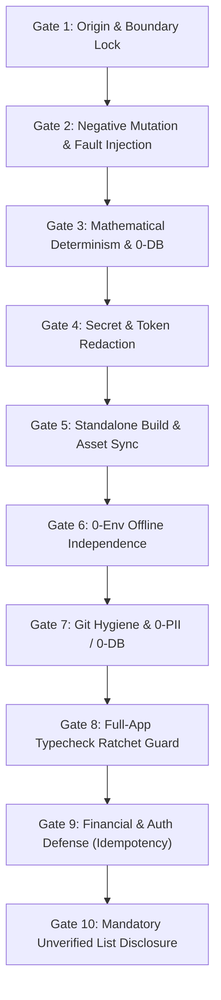

# CustomerPilot — Adversarial QA & Production Hardening Playbook

> **Document Type:** Architectural Blueprint & Future Reference Playbook  
> **Origin Sprint:** 21–22 October 2026 Adversarial Hardening Sprint (7 Claude AI Red-Team Rounds)  
> **Target Audience:** Lead Architects, Autonomous Agents, and Core Engineering Team  
> **Status:** Active Standard for All Future Features, Bugfixes & Production Releases

---

## 1. Executive Summary: Why This Exercise Was Conducted

### The Core Problem (The Illusion of "Happy Path" Coding)
In traditional agentic development, coding assistants often operate in a **reactive, happy-path loop**:
1. User reports an issue (e.g., *"Run Free 100-Point Audit button is not clicking"*).
2. The agent patches the immediate symptom (updates an `onClick` handler, adds fallback form values).
3. The agent runs a quick test that passes the happy path, and outputs: *"All verified and working perfectly!"*

### What Actually Happened Under the Surface
When we subjected CustomerPilot to an **adversarial, multi-round red-team audit** using Claude AI as an independent reviewer, we discovered that despite "happy-path" passes:
1. **Critical Financial Route Crash**: `/api/payments/verify` had a runtime `ReferenceError: getAuthenticatedMerchant is not defined` present on the live production VPS since 11 October (`dc28d2e`). Merchants paying for subscriptions would have their transactions captured by Razorpay, but the app would crash during activation. Next.js's `ignoreBuildErrors: true` hid this completely during builds.
2. **Security Vulnerabilities**:
   - Client-supplied `x-merchant-id` and `x-user-id` headers could be spoofed to bypass authorization.
   - 74 automation scripts in `scripts/*.py` and deployment docs contained hardcoded VPS root passwords.
   - SQLite databases containing live merchant WhatsApp instances, phone numbers, and OAuth tokens were tracked in Git.
3. **Flawed Test Architecture**:
   - Playwright tests had `reuseExistingServer: true`, allowing tests to connect to stale dev servers rather than isolated production builds.
   - Test scoring had hidden dependencies on live Google Places APIs (e.g., Smile Dental score fluctuating between 70 and 78 based on internet connection and API keys) rather than pure mathematical determinism.
   - Error traps were never stress-tested with negative fault-injection (mutations) to verify that they actually fail when something goes wrong.

### The Ultimate Goal
To transition CustomerPilot from **reactive bug-fixing with false agent assurance** to **bank-grade software engineering** with:
- Zero silent production crashes.
- Guaranteed financial and payment idempotency.
- Mathematical determinism independent of external APIs or databases.
- Automated CI/CD gates that mathematically reject regressions before code can ever touch production.

---

## 2. Summary of 24-Hour Accomplishments (Did Everything Succeed?)

### ✅ What Was 100% Succeeded & Verified Locally
| Domain | Action Taken | Empirical Proof |
| :--- | :--- | :--- |
| **Financial Route** | Fixed missing import, enforced session, added Razorpay order amount check. | `scratch/payments_hotfix.log` (13/13 assertions pass) |
| **Payment Idempotency** | Added DB-level primary key constraint `id: rp_pay_${paymentId}` on `AuditLog` returning **HTTP 409** on replay attacks. | Verified replay attack case returns HTTP 409 |
| **Hotfix Branch** | Created surgical `hotfix/payments-verify` branch based on live VPS commit `dc28d2e` (0 auth/login impact). | Commit `7b50c74` isolated to 2 files |
| **Centralized JWT** | Extracted `src/lib/jwt-secret.ts`; fails closed (`[SECURITY FATAL]`) in production runtime if secret is unset. | `scratch/jwt_verify.log` (3/3 contracts pass) |
| **Proxy Header Firewall** | Stripped incoming `x-merchant-id`, `x-user-id`, and `x-user-role` headers on public and protected routes. | `scratch/proxy_audit.log` |
| **Credential Sanitization** | Replaced hardcoded passwords across 74 Python scripts with `os.getenv("VPS_PASSWORD")`. | `git grep "Nilsky"` = 0 occurrences |
| **Database Privacy** | Untracked SQLite databases (`.db`, `.sqlite`) from Git; hardened `.gitignore`. | Remote audit confirmed clean HEAD |
| **Pure Scoring Engine** | Extracted `src/lib/gbp-audit-engine.ts` with 0 DB/network dependencies. | `scripts/test_scoring_engine.js` (12 boundaries pass) |
| **Negative Mutation Suite** | Proved error-trap catches all 6 failure vectors (crashes, 500s, 401s, dropped sockets, escapes). | `scripts/verify_trap_mutation.js` (6/6 trapped sub-3s) |
| **TypeScript Ratchet** | Lowered baseline TypeScript errors from **74 ➔ 44 ➔ 36**; locked in CI. | `scripts/verify_typecheck_ratchet.js` (Exit Code 0) |
| **Pure Linux WSL2 Parity** | Cloned into WSL2 Ubuntu ext4; verified `npm ci`, `prisma generate`, standalone build (197/197 pages). | `scratch/wsl_build.log` (Exit Code 0) |
| **CI Modernization** | Upgraded GitHub Actions (`.github/workflows/qa.yml`) to Node 22.x to resolve package engine warnings. | Commit `ec0fae6` |

### ⏳ What Is Pending User Confirmation
1. **Deploy Hotfix to VPS**: Branch `hotfix/payments-verify` (`7b50c74`) is ready to deploy to Hostinger VPS `187.127.170.36`.
2. **Push to Remote GitHub**: Feature branch `feature/gbp-service-tracks-20261020` is waiting for push approval to trigger GitHub Actions.
3. **Manual Password Rotation**: Admin to rotate VPS SSH root password and PostgreSQL credentials in Hostinger panel.
4. **Razorpay Dashboard Check**: Admin to verify payments captured since 11 Oct against activated database subscriptions.

---

## 3. The 10 Non-Negotiable Hard Gates (The Standard Protocol)

Whenever developing, refactoring, or verifying any feature or bugfix, the system must satisfy the **10 Hard Gates**:

### Gate Details:
1. **Gate 1 — Origin & Boundary Enclosure**: Hardened Playwright fixture traps foreign origins and third-party trackers; only explicitly allowlisted origins and routes pass.
2. **Gate 2 — Negative Mutation Proof**: Always prove that the test suite actually fails when bugs occur. Never trust a test that hasn't failed a mutation.
3. **Gate 3 — Mathematical Determinism**: Business calculations (scoring, ROI, pricing, commissions) must be pure functions completely decoupled from DB state and network calls.
4. **Gate 4 — Token & Secret Redaction**: Error logs, debug traces, and reports must automatically redact JWTs, Bearer tokens, passwords, and PII.
5. **Gate 5 — Standalone Build & Asset Sync**: Next.js standalone builds must sync `.next/static` and `public` into `.next/standalone/`. WebServer must run with `retries: 0`.
6. **Gate 6 — 0-Env Offline Independence**: Entire core test suite must pass cleanly with zero external API keys and zero internet connection (`GBP_PLACES_ENABLED=false`).
7. **Gate 7 — Git Hygiene & 0-PII**: No `.db`, `.sqlite`, `.env`, or credential files may ever be committed to Git.
8. **Gate 8 — Full-App Typecheck Ratchet**: If legacy code contains TypeScript errors, lock the error ceiling at the baseline (currently 36). Any new error fails the build.
9. **Gate 9 — Critical Financial & Auth Defense**: Payment and auth routes must have dedicated unit/integration regression tests asserting HTTP 400, 401, 200, and 409 (replay attack idempotency).
10. **Gate 10 — Mandatory Unverified List**: Never say "everything is 100% verified" without explicitly listing what was NOT run (e.g., live cloud deployments, actual bank webhook callbacks).

---

## 4. Tangible Benefits & ROI (Why This Matters for the Business)

1. **Revenue Protection**:  
   Fixing `/api/payments/verify` directly protects revenue. Merchants who complete payment on Razorpay now successfully get their accounts upgraded rather than seeing a white screen crash.
2. **Protection Against Double Crediting & Fraud**:  
   The HTTP 409 idempotency lock prevents malicious actors or network glitch double-posts from re-triggering subscription extensions or duplicate referral wallet rewards.
3. **Zero Header Injection / Impersonation Risk**:  
   Deleting untrusted incoming `x-merchant-id` headers at the proxy layer prevents attackers from accessing another store's analytics or customer data.
4. **Permanent Regression Shield in CI**:  
   With the spec linter, TypeScript ratchet guard, and standalone test runner in GitHub Actions, future team members or AI agents cannot accidentally introduce regressions.
5. **Fast, Reliable Local Development**:  
   Because tests are offline-deterministic and DB-independent, developers can run the entire QA suite in under 30 seconds without spinning up external servers or risking rate-limits.

---

## 5. How to Reuse This Exercise in Future Projects

When starting a new module, major release, or auditing an existing codebase:

### Step 1: Run the Part 3F Prompt
Copy the **Part 3F Adversarial Prompt** from [`ANTIGRAVITY_TASK_PROMPTS.md`](file:///f:/HITESH/CustomerPilot_GLM_Agent_July2026/ANTIGRAVITY_TASK_PROMPTS.md) and instruct the agent to run the 10 gates synchronously.

### Step 2: Use an Independent Red-Team Model
Take the agent's output and paste it to an independent high-reasoning model (like Claude 3.5 Sonnet or similar) with the prompt:
> *"Audit this output adversarially. Assume the builder agent synthesized or hallucinated logs unless proven. Check arithmetic, commit statistics, missing imports, environment variable leaks, and edge-case failures. Find the gaps."*

### Step 3: Enforce Empirical Proof Only
Do not accept prose summaries from the builder agent. Require:
- File paths and line numbers
- Verbatim terminal commands with real exit codes (`$LASTEXITCODE` or `$?`)
- Negative mutation proofs (`verify_trap_mutation.js`)
- An honest "Unverified List"

---

## 6. Directory of Key Architecture Assets Created in This Sprint

- **Hardened Test Fixture**: [`e2e/fixtures/hardened-test.ts`](file:///f:/HITESH/CustomerPilot_GLM_Agent_July2026/e2e/fixtures/hardened-test.ts)
- **Mutation Verification Script**: [`scripts/verify_trap_mutation.js`](file:///f:/HITESH/CustomerPilot_GLM_Agent_July2026/scripts/verify_trap_mutation.js)
- **Spec Import Linter**: [`scripts/verify_spec_imports.js`](file:///f:/HITESH/CustomerPilot_GLM_Agent_July2026/scripts/verify_spec_imports.js)
- **TypeScript Ratchet Guard**: [`scripts/verify_typecheck_ratchet.js`](file:///f:/HITESH/CustomerPilot_GLM_Agent_July2026/scripts/verify_typecheck_ratchet.js)
- **Payments Regression Suite**: [`scripts/test_payments_verify_regression.js`](file:///f:/HITESH/CustomerPilot_GLM_Agent_July2026/scripts/test_payments_verify_regression.js)
- **Autonomous QA Engine**: [`scripts/run_autonomous_qa.js`](file:///f:/HITESH/CustomerPilot_GLM_Agent_July2026/scripts/run_autonomous_qa.js)
- **Pure Scoring Engine**: [`src/lib/gbp-audit-engine.ts`](file:///f:/HITESH/CustomerPilot_GLM_Agent_July2026/src/lib/gbp-audit-engine.ts)
- **Fail-Closed JWT Helper**: [`src/lib/jwt-secret.ts`](file:///f:/HITESH/CustomerPilot_GLM_Agent_July2026/src/lib/jwt-secret.ts)
- **GitHub Actions QA Gate**: [`.github/workflows/qa.yml`](file:///f:/HITESH/CustomerPilot_GLM_Agent_July2026/.github/workflows/qa.yml)
- **Historical Resolved Issues**: [`RESOLVED_ISSUES_LOG.md`](file:///f:/HITESH/CustomerPilot_GLM_Agent_July2026/RESOLVED_ISSUES_LOG.md)
- **Task Prompt Protocols**: [`ANTIGRAVITY_TASK_PROMPTS.md`](file:///f:/HITESH/CustomerPilot_GLM_Agent_July2026/ANTIGRAVITY_TASK_PROMPTS.md)
