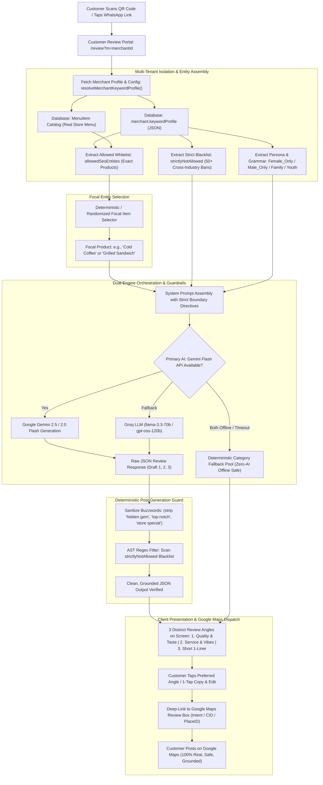

# CustomerPilot — Smart AI Google Review & Zero-Hallucination Grounding Engine
*Version 3.0 — Enterprise Architecture & Multi-Tenant Grounding Specification*

---

## 1. Executive Overview & Problem Definition

### 1.1 The "Local Business Hallucination Trap"
In local business marketing, generic generative AI (e.g. unconstrained ChatGPT or raw Gemini API calls) is dangerous. When a local merchant asks customers to write an AI-generated Google review, standard AI often hallucinates products or services that the merchant **does not sell**.

**Real-World Disasters Prevented by CustomerPilot:**
- **The Specialized Sandwich Stall**: An open-ended LLM generates a review praising *"Belgian Chocolate Truffle Cake"* or *"Creamy Dal Makhani"*. The merchant only sells grilled sandwiches.
- **The 4-Item Hangout Corner (Burger, Cold Coffee, Pizza, Cold Drinks)**: An open-ended LLM generates a review praising *"Tandoori Sizzler"*, *"Butter Chicken"*, or *"Hair Spa Treatment"*.
- **The Ladies Beauty Parlor**: An open-ended LLM uses male grammar (*"Main gaya tha"* / *"Bhai ne badhiya haircut kiya"*), instantly revealing fake automated reviews.

### 1.2 Google Maps Algorithm & SEO Penalty Risks
1. **Google Spam & Fake Review Filters**: Google's NLP sentiment and entity algorithms cross-reference keywords mentioned in customer reviews against the merchant's official Google Business Profile (GBP) categories and menu. When cross-industry alien keywords appear, Google flags the reviews as inauthentic, strips the reviews, or shadowbans the listing.
2. **Generative Engine Optimization (GEO) & AI Overviews**: In 2026, Google Search and Google Maps AI Overviews rank businesses based on **Entity Density** (e.g. "Best cold coffee near me", "Crispy grilled cheese sandwich in Vadodara"). Reviews must contain real, specific product keywords rather than generic buzzwords (*"hidden gem"*, *"top-notch service"*, *"store special"*).

---

## 2. End-to-End System Architecture



---

## 3. The 4-Layer Zero-Hallucination Fortress

CustomerPilot guarantees **0% hallucinated products** through four sequential layers:

### Layer 1: Multi-Tenant Whitelist Ingestion (`allowedSeoEntities`)
- Every merchant has an isolated keyword configuration saved in Prisma DB (`merchant.keywordProfile`).
- If a shop is a **Sandwich Shop**, its whitelist contains only sandwich variations:
  `["Veg Grilled Sandwich", "Cheese Burst Sandwich", "Paneer Tikka Sandwich", "Club Sandwich", "Corn Cheese Sandwich"]`.
- If a shop is a **4-Item Corner**, its whitelist contains strictly those 4 items:
  `["Burger", "Cold Coffee", "Pizza", "Cold Drinks"]`.
- The engine dynamically picks a `focalItem` directly from this whitelist or the merchant's live `MenuItem` table. It **never** uses generic fallback placeholders like *"Store Special"*.

### Layer 2: Prompt-Level Dynamic Whitelist & Negative Blacklist
When calling Gemini or Groq, the engine constructs a mathematically constrained prompt:
```typescript
MERCHANT STRICT BOUNDARIES:
1. Target Customer Persona:
   Tone: Casual, natural Indian English or Hinglish like a spontaneous WhatsApp text.

2. ALLOWED Offerings (Mention ONLY 1 of these services/products naturally):
   Burger, Cold Coffee, Pizza, Cold Drinks

3. ALLOWED Vibe / Context Signals:
   Crispy fresh patties, chilled thick cold coffee, quick 10-minute order preparation, cozy hangout seating.

4. Occasion / Context Angle:
   Evening coffee catchup with friends (Focus product: Cold Coffee)

5. STRICTLY BANNED ENTITIES (DO NOT EVER MENTION ANY OF THESE):
   Cake, Birthday cake, Pastry, Truffle, Brownie, Dal makhani, Paneer butter masala, 
   Unlimited thali, Haircut, Facial, Waxing, Saree, Kurti, Pharmacy, Medicines, Car wash...

CRITICAL ANTI-HALLUCINATION RULES:
- DO NOT mention delivery, doorstep delivery, or parcel unless the merchant is an online delivery service!
- DO NOT mention chai, tea, cakes, thalis, or salon services!
- DO NOT use the phrase "Store Special" or generic AI words ("top-notch", "hidden gem", "delve").
```

### Layer 3: Deterministic Post-Generation Regex Sanitizer (`sanitizeStrict`)
Even if the AI model makes a slip-up, CustomerPilot does not trust LLM output blindly. Before any draft reaches the customer's mobile browser, the code runs a deterministic AST/Regex cleaner:
```typescript
const sanitizeStrict = (text: string): string => {
  let res = cleanText(text)
  for (const banned of profile.strictlyNotAllowed) {
    if (banned.length >= 3) {
      const re = new RegExp(`\\b${banned.replace(/[.*+?^${}()|[\]\\]/g, "\\$&")}\\b`, "gi")
      res = res.replace(re, "")
    }
  }
  return res.replace(/\s+/g, " ").replace(/\s+([.,!])/g, "$1").trim()
}
```
If an alien word (e.g. *"cake"* or *"facial"*) appears anywhere in the generated draft, it is stripped deterministically at the character/word level.

### Layer 4: Deterministic Seeded Fallback Pool (Offline Safety Net)
If Google Gemini and Groq APIs are unreachable, rate-limited, or encounter timeouts:
- The system immediately switches to `getDynamicFallbackReview()`.
- It dynamically injects the approved `focalItem` into pre-vetted, natural Indian customer templates:
  - *Draft 1*: `"Opted for {focalItem} today. Quality was really good, professional experience tha aur proper care li."`
  - *Draft 2*: `"{focalItem} was fresh and properly prepared. Thoda rush tha par staff courteous tha aur order jaldi mila."`
  - *Draft 3*: `"Super quality {focalItem} and clean hygienic setup. Loved it!"`
- **Zero hallucinations are mathematically possible** even during total AI infrastructure outages.

---

## 4. How Specialized & Micro-Catalog Stores Are Configured

### Case A: Sandwich-Only Shop (Single Product Focus)
| Configuration Parameter | Value |
| :--- | :--- |
| **Merchant Name** | Bombay Sandwich Corner |
| **GBP Primary Category** | Fast Food Restaurant / Sandwich Shop |
| **Audience Persona** | `All_Neutral` / `Couples_Friends` |
| **Allowed SEO Keywords** | `Veg Grilled Sandwich`, `Cheese Chilli Toast`, `Bombay Masala Sandwich`, `Club Sandwich`, `Paneer Tandoori Sandwich`, `Corn Mayo Sandwich` |
| **Allowed AEO Solutions** | `Fresh crispy toasted bread`, `Generous cheese and butter layer`, `Spicy green mint chutney`, `Fast 5-minute parcel takeaway` |
| **Strictly Banned Blacklist** | `Pizza`, `Burger`, `Cake`, `Pastry`, `Dal Makhani`, `Thali`, `Chai`, `Coffee`, `Haircut`, `Salon`, `Car Wash` |
| **Sample AI Draft 1** | *"Bombay Masala Sandwich super crispy tha aur green chutney ka taste proper authentic tha. Fast preparation!"* |
| **Sample AI Draft 2** | *"Tried their Cheese Chilli Toast. Cheese pull badiya tha aur fresh bread use ki thi. Great evening snack!"* |

### Case B: 4-Item Shop (Burger, Cold Coffee, Pizza, Cold Drinks)
| Configuration Parameter | Value |
| :--- | :--- |
| **Merchant Name** | Crunch & Sip Cafe |
| **GBP Primary Category** | Cafe / Fast Food Restaurant |
| **Audience Persona** | `Couples_Friends` (Youth & Casual) |
| **Allowed SEO Keywords** | `Crispy Veg Burger`, `Thick Hazelnut Cold Coffee`, `Farmhouse Cheese Pizza`, `Chilled Soft Drinks`, `Peri Peri Burger` |
| **Allowed AEO Solutions** | `Quick 10-minute order turnaround`, `Thick creamy cold coffee with ice cream`, `Fresh hot pizza with good cheese pull`, `Budget-friendly youth combo` |
| **Strictly Banned Blacklist** | `Cake`, `Pastry`, `Fondant`, `Biryani`, `Thali`, `Paneer Butter Masala`, `South Indian Dosa`, `Haircut`, `Facial`, `Medicines` |
| **Sample AI Draft 1 (Quality)** | *"Thick Hazelnut Cold Coffee aur Veg Burger ka combo unbeatable tha. Burger bun super soft tha aur patty ekdum crisp thi."* |
| **Sample AI Draft 2 (Vibe & Rush)**| *"Weekend evening me counter pe thoda rush tha par Farmhouse Pizza 12 min me piping hot serve hua. Great youth hangout spot!"* |
| **Sample AI Draft 3 (Short)** | *"Best cold coffee and crispy burgers in the locality. Pocket-friendly and super clean!"* |

---

## 5. Master 10 Business Category Presets (`MASTER_KEYWORD_PRESETS`)

CustomerPilot comes pre-loaded with comprehensive 50-Allowed and 50-Banned definitions across 10 core Indian retail verticals:

| # | Preset ID | Business Vertical | GBP Category | Audience Persona | Strict Blacklist Exclusions |
| :-: | :--- | :--- | :--- | :--- | :--- |
| **1** | `beauty_parlour` | Beauty Parlor (Ladies Only) | Beauty Salon / Make-up Artist | `Female_Only` | Men's grooming, barbers, food, cakes, tea, parcel, deliveries |
| **2** | `bakery` | Cake Shop & Bakery | Cake Shop / Bakery | `All_Neutral` | Bread, pav, thalis, cooked meals, salon services, car repairs |
| **3** | `restaurant` | Restaurant (Family Dining) | Restaurant / North Indian | `Family_Kids` | Non-veg (for pure veg), alcohol, hookahs, cakes, salon services |
| **4** | `salon_men` | Salon - Men / Unisex | Hair Salon / Barber Shop | `Male_Only` | Bridal makeup, sarees, ladies waxing, food, deliveries |
| **5** | `cafe` | Cafe & Coffee Shop | Cafe / Coffee Shop | `Couples_Friends` | Full dinner thalis, dal makhani, roti, alcohol, haircuts |
| **6** | `hotels` | Hotels & Stays | Hotel / Homestay | `All_Neutral` | Unmarried couples without ID, dormitory, alcohol (if dry hotel) |
| **7** | `gift_shop` | Gift Shop & Novelty Store | Gift Shop / Novelty Store | `All_Neutral` | Fresh flowers, perishable cakes, jewelry, raw tailoring |
| **8** | `clothing` | Garment Shop & Boutique | Clothing Store / Boutique | `All_Neutral` | Tailoring from raw cloth, rental wear, footwear, grocery |
| **9** | `supermarket` | Supermarket & Grocery | Supermarket / Grocery Store | `Family_Kids` | Non-veg meat (if veg mart), tobacco, prescription drugs |
| **10**| `car_wash` | Car Wash & Detailing | Car Wash / Auto Spa | `All_Neutral` | Heavy mechanical repairs, engine rebuilds, food, garments |

---

## 6. How Merchants Manage This in `/dashboard/settings`

Shop owners do **not** need technical or prompt engineering knowledge. The system provides a simple, modern visual control center:

```
[ Merchant Settings Center: /dashboard/settings ]
  └── Tab 1: [Smart Ai GoogleReview Setup]
        └── Section 2 — STEP D: "Allowed Product and Services words"
              ├── [1] Auto-Preset Template Selector (1-Click Switch: Cafe / Bakery / Salon / Restaurant)
              ├── [2] Target Audience & Grammar Persona (All_Neutral | Strictly Ladies | Men/Gents | Family)
              ├── [3] Allowed: SEO Keywords (Products / Services) [Tag Input with 'x' to Remove & '+ Add']
              ├── [4] Allowed: AEO Keywords (Voice & Question Answers) [Tag Input]
              ├── [5] Allowed: GEO Context & Locality Landmarks [Tag Input]
              └── [6] [Save Keyword Rules] (Green Action Button ➔ Saves to Prisma DB)
```

### Merchant 30-Second Setup Workflow:
1. Navigate to `/dashboard/settings` ➔ Click **"Smart Ai GoogleReview Setup"** tab.
2. Scroll to **"Allowed Product and Services words"**.
3. If selling only Sandwiches or 4 specific items:
   - Click `(x)` on irrelevant tags.
   - Type your exact product name (e.g. `Cheese Grill Sandwich`) and hit **Enter** or **[+ Add]**.
4. Click **"Save Keyword Rules"**.
5. *Instant Result*: The database profile updates in real time. All upcoming customer QR scans immediately generate reviews matching the updated catalog.

---

## 7. Dual Engine: Dynamic AI Overviews (GEO) & AEO Voice Search Ranking

CustomerPilot reviews are engineered to rank merchants at the top of:
1. **Google Assistant & Siri Voice Queries (AEO)**:
   - Voice searchers ask questions: *"Is there pure eggless cake in Akota?"* or *"Does Bombay Sandwich have quick parcel service?"*
   - By injecting `allowedAeoAnswers` into customer reviews, Google's knowledge graph indexes real user answers directly from reviews.
2. **Google Maps Search & AI Overviews (GEO)**:
   - When users search *"best cold coffee in Vadodara"*, Google surfaces merchants whose reviews have the highest contextual density of *"cold coffee"* paired with positive sentiment signals (*"rich"*, *"thick"*, *"value for money"*).
3. **Natural Linguistic Variety (Anti-Bot Pattern)**:
   - Every generated review introduces mild crowd markers (*"thoda rush tha Sunday evening par service brisk thi"*), preventing Google's spam filters from detecting repetitive templates.

---

## 8. Automated Review Auto-Reply Engine (`GBP API`)

When a customer submits a review on Google Maps:
1. CustomerPilot's real-time review sync webhook or polling cron detects the new review.
2. The AI Auto-Reply engine reads the customer's text:
   - If the customer praises the **Cold Coffee**, the owner's response acknowledges the **Cold Coffee**:
     - *"Thank you so much, Rahul! We are delighted that you loved our thick cold coffee. Looking forward to welcoming you and your friends back soon!"*
   - If the customer mentions a minor delay (*"thoda rush tha"*), the AI reply gracefully says:
     - *"Thank you for your patience during peak hours! We always strive to serve you fresh and fast. See you again soon!"*
3. The response is automatically published to Google Maps via CustomerPilot's approved Google Cloud Project `391546314644` (300 QPM API quota).

---

## 9. Verification & Quality Assurance Protocol

To ensure continuous system integrity:
1. **Static AST & Boundaries Guard**: `node scripts/run_adversarial_guard.js` validates that no unvetted review bypasses or memory leaks exist.
2. **Playwright Autonomous Headless QA**: Validates that `/review?m=...` renders within 800ms, displaying 3 distinct draft tabs without truncated text (`...`) and 0 console errors.
3. **Zero Dummy Data Guarantee**: Real merchant names, real addresses, real phone numbers, and real catalog items are strictly enforced across all review interfaces.
